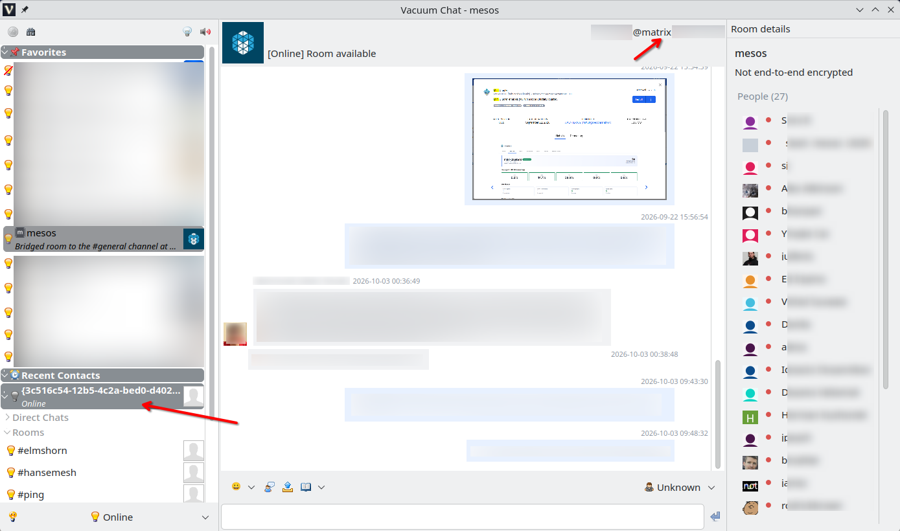

# Vacuum Chat

Vacuum Chat is a Qt 6 desktop messaging application with a modular plugin
architecture. It offers XMPP, Matrix, APRS Chat, and Meshcore plugin,
with shared interfaces for conversations, presence, rosters, notifications, and
message display.

Vacuum Chat is a hard fork of [Vacuum-IM](https://github.com/vacuum-im/vacuum-im). Thanks
to the original authors.

## Features

- XMPP accounts, presence and contact rosters
- One-to-one chats and multi-user chat rooms
- Message history and archive support
- File transfer, notifications, and configurable message styles
- Extensible functionality provided by loadable plugins
- Matrix rooms and conversations integrated into the shared chat UI
- Optional Matrix end-to-end encryption support when `libolm` is available at
  build time
- MeshCore account

| Chat Protocol | Status | Comment |
|---------------|--------|-----------------------------------------------|
| Matrix        | ✔️     | Integrated with rooms, messages, reactions, e2ee, etc. |
| XMPP          | ✔️     | Classic protocol supporting PubSub, MUC, and offline messages. |
| Meshcore      | ✔️     | Custom distributed architecture for decentralized communication. |
| Discord       | -      | Planned for future release, no release date yet. |
| IRC           | -      | Planned for future release, no release date yet. |

## Requirements

- CMake 3.16 or newer
- A C++ compiler supported by Qt 6
- Qt 6 components: Core, Gui, Widgets, Network, Xml, and Sql
- Python 3 for the protocol smoke tests

Matrix encryption dependencies are optional. CMake enables Matrix E2EE when it
finds `libolm`; OpenSSL enables the Matrix Secure Secret Storage (SSSS)
functionality. Without these libraries, the corresponding Matrix cryptographic
features are disabled.

## Spell checking

The Spell Checker plugin needs a Hunspell dictionary for the selected language;
installing the Hunspell library alone is not enough. A dictionary consists of a
matching `.dic` and `.aff` file. On Linux, dictionaries are searched in
`/usr/share/hunspell` and `/usr/share/myspell`, as well as the plugin data
folder's `spelldicts` directory. On OS/2 and Windows, place them in a `hunspell`
folder next to the application. Enable the Spell Checker plugin and select an
installed dictionary from the editor's context menu. Spell checking is
unavailable when no matching dictionary is found.

## Build

Configure and build the main application from the repository root:

```sh
mkdir build
cd build
cmake -DRUN_FROM_BUILD_DIR=ON -DHAVE_OLM=1 ..
make
```

Matrix encryption support is detected from the available `libolm` and OpenSSL
dependencies; no `HAVE_OLM` CMake option is required.

### Native build on OS/2

A native build requires an OS/2 C++ compiler supported by the installed Qt 6
package, the Qt 6 development files for Core, Gui, Widgets, Network, Xml, and
Sql, and OS/2 builds of CMake and Make. Ensure the compiler, CMake, Make, Qt
headers, libraries, and Qt CMake package files are available in the OS/2 build
environment. From the repository root, configure and build in a fresh directory:

```sh
mkdir build
cd build
cmake -DRUN_FROM_BUILD_DIR=ON -DHAVE_OLM=1 -DBUILD_SHARED_LIBS=ON ..
make
```

The `OS2` CMake platform branch applies the OS/2-specific compiler and linker
settings. If CMake cannot locate Qt, set `CMAKE_PREFIX_PATH` to the prefix where
the native OS/2 Qt 6 package is installed. The build command produces build
tree artifacts; it does not install them or prove that the application runs on
OS/2.

### Cross-compiling for OS/2 from Linux

Cross-compiling requires a working OS/2 target compiler/sysroot and an installed
OS/2 Qt 6 target package, plus a separate native Linux Qt 6 host-tools
installation. The target Qt libraries and CMake packages are used for linking;
Linux host tools such as `moc`, `rcc`, and `uic` must come from the host Qt
installation. Do not use OS/2 executables as host tools or mix host Qt libraries
into the target link.

Set these paths to the prefixes on your build host, then configure once in a
fresh out-of-tree build directory. The `qt.toolchain.cmake` shipped with the
OS/2 Qt package selects the target toolchain. Adjust the build directory to
match the build policy for your environment.

```sh
QT_OS2_PREFIX=/path/to/os2-qt6-prefix
QT_HOST_PREFIX=/path/to/linux-qt6-host-prefix
BUILD_DIR=/path/to/build-vacuum-os2

cmake -S . -B "$BUILD_DIR" \
  -DCMAKE_TOOLCHAIN_FILE="$QT_OS2_PREFIX/lib/cmake/Qt6/qt.toolchain.cmake" \
  -DCMAKE_PREFIX_PATH="$QT_OS2_PREFIX" \
  -DQt6_DIR="$QT_OS2_PREFIX/lib/cmake/Qt6" \
  -DQt6Core_DIR="$QT_OS2_PREFIX/lib/cmake/Qt6Core" \
  -DQt6Gui_DIR="$QT_OS2_PREFIX/lib/cmake/Qt6Gui" \
  -DQt6Widgets_DIR="$QT_OS2_PREFIX/lib/cmake/Qt6Widgets" \
  -DQt6Network_DIR="$QT_OS2_PREFIX/lib/cmake/Qt6Network" \
  -DQt6Xml_DIR="$QT_OS2_PREFIX/lib/cmake/Qt6Xml" \
  -DQt6Sql_DIR="$QT_OS2_PREFIX/lib/cmake/Qt6Sql" \
  -DQT_HOST_PATH="$QT_HOST_PREFIX" \
  -DQt6CoreTools_DIR="$QT_HOST_PREFIX/lib/cmake/Qt6CoreTools" \
  -DQt6GuiTools_DIR="$QT_HOST_PREFIX/lib/cmake/Qt6GuiTools" \
  -DQt6WidgetsTools_DIR="$QT_HOST_PREFIX/lib/cmake/Qt6WidgetsTools" \
  -DRUN_FROM_BUILD_DIR=OFF \
  -DBUILD_SHARED_LIBS=ON \
  -DCMAKE_BUILD_TYPE=Release \
  -DHAVE_OLM=1

cmake --build "$BUILD_DIR" --parallel 2
```

Keep the target Qt prefix, host Qt prefix, and build directory separate. If the
OS/2 Qt installation or toolchain changes, use a new build directory rather
than reusing a CMake cache configured with different compiler or Qt paths. Check
the configure summary and `CMakeCache.txt` to confirm that Qt target packages
come from `QT_OS2_PREFIX`, while `QT_HOST_PATH` and the `Qt6*Tools_DIR`
packages come from `QT_HOST_PREFIX`. A successful cross-build only produces
OS/2 build artifacts; installation, transfer to an OS/2 system, and runtime
verification are separate steps.

## Packaging under Linux

On Linux, CPack can create a Debian package; when `bsdtar` and `zstd` are
available, its default generator set also creates an Arch Linux
`.pkg.tar.zst` package:

```sh
mkdir build
cd build
cmake -DRUN_FROM_BUILD_DIR=OFF -DHAVE_OLM=1 -DCPACK_BINARY_DEB=true ..
make package
```

## Tests

Run the project checks with:

```sh
make check
```

This builds the `chatmessagehandler` and `recentcontacts` targets, runs the
Matrix protocol smoke suite, and checks the Git diff for whitespace errors. The
Matrix smoke suite uses a local mock HTTP server and does not require a live
homeserver.

An optional live Matrix smoke test runs when all of these environment variables
are set:

- `MATRIX_HOMESERVER`
- `MATRIX_ACCESS_TOKEN`
- `MATRIX_USER_ID`
- `MATRIX_HOME_ROOM`

Keep access tokens private; do not commit them or place them in this README.

## Project layout

- `src/interfaces/` — protocol-neutral plugin and application interfaces
- `src/plugins/` — XMPP, Matrix, chat UI, roster, notification, and other
  plugins
- `src/utils/` — shared application utilities
- `tests/` — protocol and integration smoke tests

## License

Vacuum Chat is distributed under the GNU General Public License, version 3. See
[`COPYING`](COPYING) for the full license text.

## Screenshots


